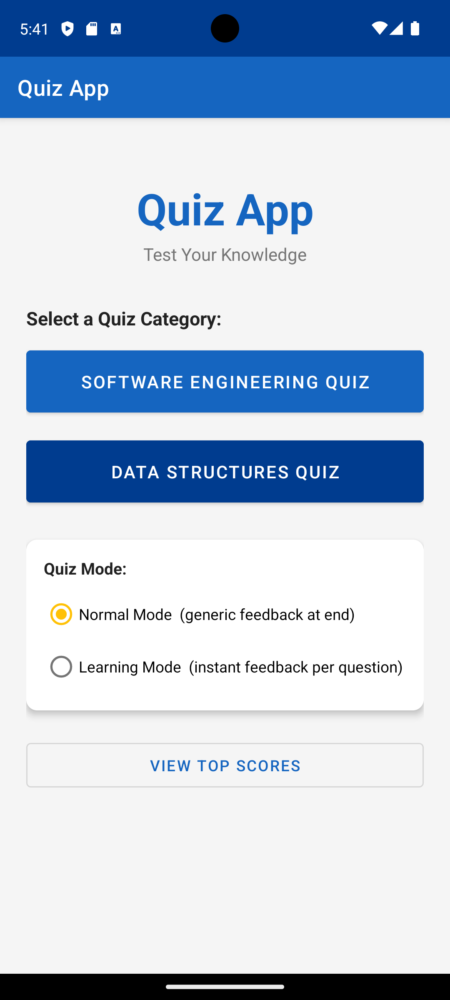
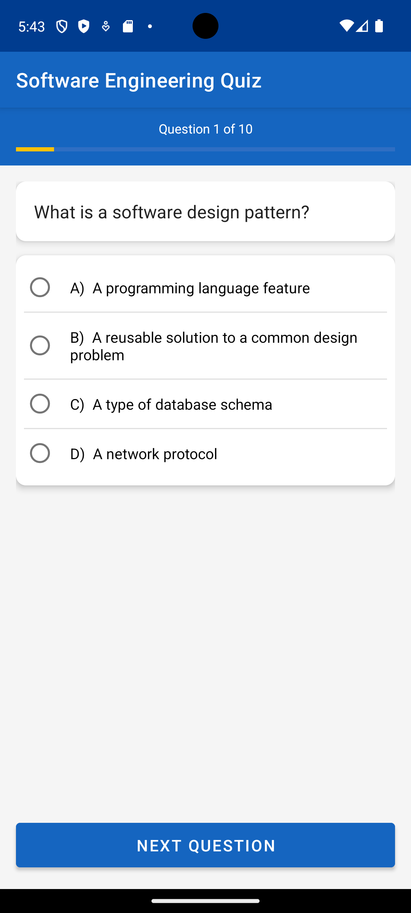
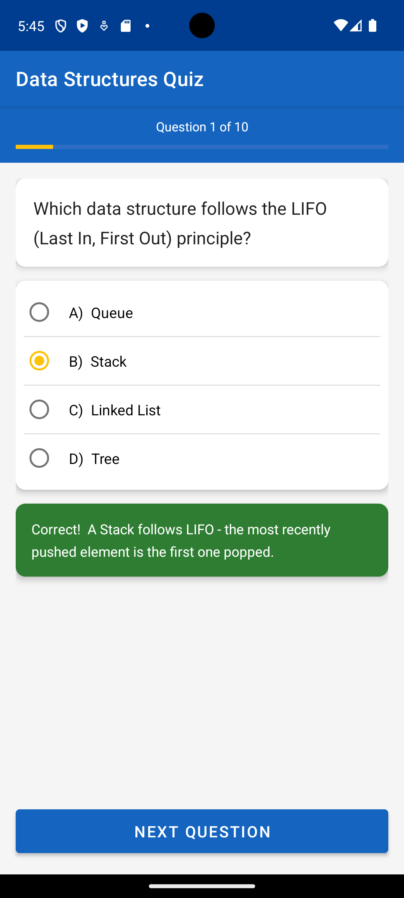
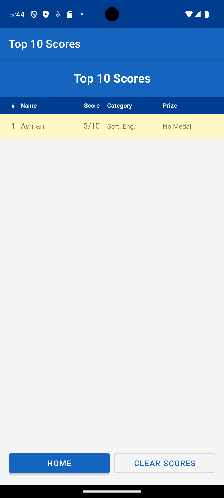

# Welcome To My Quiz – Android Quiz App

A native Android quiz app built in Java with Android Studio for the Mobile Web App Development module at the University of West London (2025/26).

## Features

- Two quiz categories: Software Engineering and Data Structures
- Randomised question order each time you play
- Two play modes:
  - **Normal mode:** answer all the questions, then see your score
  - **Learning mode:** instant feedback after each answer
- Bronze, Silver and Gold medals based on your score
- Top-10 leaderboard that is saved on the device between sessions
- Material Components UI with input validation

## Tech stack

- Java, XML layouts
- Android Studio
- SharedPreferences and Gson (JSON) for saving the leaderboard
- Material Components

## How it is built

The app is split into 7 classes that separate the question data, the saved leaderboard and the screens. I wrote the leaderboard saving myself with SharedPreferences and Gson instead of using a database, to understand how Android handles activity lifecycles and saved state.

## Run it

1. Clone the repository
2. Open the project in Android Studio
3. Let Gradle sync, then run it on an emulator or a physical Android device

## Screenshots

### Start Screen

### Quiz Screen

### Learning Mode Feedback

### Result Screen

### Leaderboard

## Author

Ayman El Moudden Afilal – BSc (Hons) Information Technology, University of West London
LinkedIn: https://www.linkedin.com/in/ayman-el-moudden-afilal/
